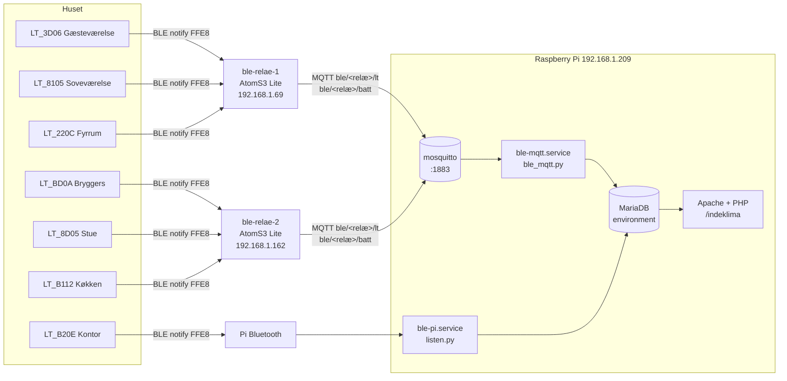

# Indeklima – BLE-temperaturmålere

Dokumentation af systemet, der opsamler temperatur, luftfugtighed og batteriniveau fra syv LT_-målere rundt i huset og viser dem på `itkur.dk/indeklima`.

*Senest opdateret: 10. oktober 2026*

---

## 1. Overblik



Hvis diagrammet ikke vises:

```text
LT-målere ──BLE──▶ ble-relae-1 / ble-relae-2 ──MQTT──▶ mosquitto ──▶ ble_mqtt.py ──┐
LT-måler (Kontor) ──BLE──▶ Pi'ens Bluetooth ──────────────────────▶ listen.py ────┼──▶ MariaDB ──▶ itkur.dk/indeklima
                                                                                  │
```

### Grundprincipper

- **Målerne sender ikke data i advertisements.** En gateway skal *forbinde* til måleren og abonnere på notifikationer på karakteristikken `FFE8`.
- **En måler kan kun have én forbindelse ad gangen.** Derfor er hver måler tildelt præcis én gateway i kolonnen `sensors.gateway`, og relæernes YAML skal stemme overens med den.
- **Målerne sender kun, når værdien ændrer sig.** Der kan gå 10–30 minutter mellem målinger i et rum med stabil temperatur. Det er normalt.
- **Relæerne bruger kort forbindelse (fra 28. okt 2026).** Hver måler forbindes hvert 10. minut, batteriet læses, relæet venter på én `FFE8`-frame (højst 45 s) og afbryder. Permanent forbindelse fik måleren til at sende ca. hvert 10. sekund døgnet rundt og drænede batteriet. Målerne på samme relæ er forskudt 60 s (`offset` i `ble-relae-X.yaml`).
- **Livstegn = batterilæsning.** Relæerne læser batteriet ved hver forbindelse, dvs. hvert 10. minut. `sensors.battery_at` er derfor den reelle indikator for, om måleren kan nås.
- **BlueZ' input/hog-plugin er slået fra på piprod.** Målerne annoncerer HID-servicen `0x1812`, så BlueZ ellers behandler dem som tastaturer: markerer dem `Trusted`, auto-forbinder og holder forbindelsen. Override: `systemd/bluetooth.service.d/noinput.conf`.
- **Målere må ikke være `Trusted` i BlueZ.** Så forbinder bluetoothd selv til dem og holder forbindelsen, måleren advertiser ikke, `listen.py` melder "ikke fundet", og batteriet drænes. `listen.py` fjerner markeringen før hver forbindelse. Manuelt: `bluetoothctl untrust <MAC>` og `bluetoothctl remove <MAC>`.
- **Batteriprocenten er ubrugelig.** Målerne melder fast 90 % via `2A19`, også med nye batterier. Svage batterier viser sig i stedet som mislykkede forbindelser (`battery_at` bliver gammel).

---

## 2. Hardware

| Enhed | Model | IP | Rolle |
|---|---|---|---|
| Raspberry Pi | (prod) | 192.168.1.209 | MQTT-broker, database, services, web (itkur.dk) |
| ble-relae-1 | M5Stack AtomS3 Lite (ESP32-S3) | 192.168.1.69 | BLE-relæ |
| ble-relae-2 | M5Stack AtomS3 Lite (ESP32-S3) | 192.168.1.162 | BLE-relæ |
| 7 × måler | LT_-termometer (BLE) | – | Temperatur, fugt, batteri |

> ⚠️ Relæernes IP'er er byttet rundt én gang i løbet af opsætningen. **Lav DHCP-reservationer i routeren** og sæt en mærkat på hver AtomS3.

### AtomS3 Lite – pins

| Funktion | GPIO |
|---|---|
| RGB-LED (WS2812) | 35 |
| Knap | 41 |
| Download-mode | Hold knappen inde ~2 sek. ved tilslutning, til LED'en blinker grønt |

---

## 3. Målere og fordeling

| id | Navn | Bluetooth-navn | MAC | Gateway |
|---|---|---|---|---|
| 1 | Køkken | LT_B112 | F0:8F:09:55:B1:12 | ble-relae-2 |
| 2 | Kontor | LT_B20E | F0:B9:6A:D2:B2:0E | raspberrypi |
| 3 | Fyrrum | LT_220C | E2:FC:33:72:22:0C | ble-relae-1 |
| 4 | Stue | LT_8D05 | D5:85:47:C7:8D:05 | ble-relae-2 |
| 5 | Soveværelse | LT_8105 | D7:2A:AA:90:81:05 | ble-relae-1 |
| 6 | Gæsteværelse | LT_3D06 | F3:0F:F1:C5:3D:06 | ble-relae-1 |
| 7 | Bryggers | LT_BD0A | DA:BD:DB:25:BD:0A | ble-relae-2 |

Fordelingen er valgt ud fra målt signalstyrke (RSSI). Tommelfingerregel for en stabil forbindelse: **bedre end ca. -90 dBm**. Annonceringer kan fanges ned til -100, men en forbindelse kræver mere.

### Målerens BLE-profil

| Service | Karakteristik | Egenskab | Brug |
|---|---|---|---|
| `FFE5` | `FFE8` | notify | Måledata |
| `FFE5` | `FFE9` | write-without-response | (ikke brugt) |
| `180F` | `2A19` | read, notify | Batteriniveau i % (1 byte) |
| `180A` | diverse | read | Device information |

### Rammeformat (notify på FFE8)

```text
AA AA A2 .. .. TH TL HH HL .. .. .. 55
 0  1  2  3  4  5  6  7  8          sidste
```

| Felt | Bytes | Beregning |
|---|---|---|
| Header | 0–2 | skal være `AA AA A2` |
| Temperatur | 5–6 | `(b5 << 8) + b6`, divideret med 10 → °C |
| Fugt | 7–8 | `(b7 << 8) + b8`, divideret med 10 → % |
| Slutbyte | sidste | skal være `55` |
| Længde | – | mindst 13 bytes |

> Negative temperaturer håndteres ikke i dag (ingen fortegnsbehandling). Det er kun relevant, hvis en måler kommer udendørs.

---

## 4. ESP32-relæer (ESPHome)

### Placering af filer

```text
/home/kao/esphome/
├── secrets.yaml          # wifi_ssid, wifi_password, ota_password, api_key
├── ble-common.yaml       # fælles konfiguration for begge relæer
├── lt-sensor.yaml        # skabelon: én LT-måler
├── ble-relae-1.yaml      # relæ 1: navn + hvilke målere
└── ble-relae-2.yaml      # relæ 2: navn + hvilke målere
```

ESPHome er installeret i et venv: `~/esphome-venv`.

Alias i `~/.bashrc`:

```bash
alias esp='source ~/esphome-venv/bin/activate && cd ~/esphome'
```

### ble-relae-1.yaml

```yaml
substitutions:
  name: ble-relae-1

packages:
  common: !include ble-common.yaml
  lt_3d06: !include { file: lt-sensor.yaml, vars: { mac: "F3:0F:F1:C5:3D:06", sid: lt_3d06 } }
  lt_8105: !include { file: lt-sensor.yaml, vars: { mac: "D7:2A:AA:90:81:05", sid: lt_8105 } }
  lt_220c: !include { file: lt-sensor.yaml, vars: { mac: "E2:FC:33:72:22:0C", sid: lt_220c } }
```

### ble-relae-2.yaml

```yaml
substitutions:
  name: ble-relae-2

packages:
  common: !include ble-common.yaml
  lt_bd0a: !include { file: lt-sensor.yaml, vars: { mac: "DA:BD:DB:25:BD:0A", sid: lt_bd0a } }
  lt_8d05: !include { file: lt-sensor.yaml, vars: { mac: "D5:85:47:C7:8D:05", sid: lt_8d05 } }
  lt_b112: !include { file: lt-sensor.yaml, vars: { mac: "F0:8F:09:55:B1:12", sid: lt_b112 } }
```

Hver `!include`-linje skal slutte med `} }`, fordi der lukkes både for `vars` og for selve `!include`.

ESPHome tillader som standard **3 samtidige BLE-forbindelser** pr. relæ. Skal et relæ have flere, tilføjes i `ble-common.yaml`:

```yaml
esp32_ble:
  max_connections: 5
```

### lt-sensor.yaml (skabelon)

```yaml
ble_client:
  - mac_address: ${mac}
    id: ${sid}

sensor:
  # Temperatur: notify på FFE8, rå ramme sendes til MQTT
  - platform: ble_client
    type: characteristic
    ble_client_id: ${sid}
    name: "${sid} temperatur"
    service_uuid: "FFE5"
    characteristic_uuid: "FFE8"
    notify: true
    update_interval: never
    unit_of_measurement: "°C"
    accuracy_decimals: 1
    lambda: |-
      if (x.size() < 13 || x[0] != 0xAA || x[1] != 0xAA || x[2] != 0xA2 || x.back() != 0x55)
        return NAN;
      std::string p = "{\"mac\":\"${mac}\",\"gw\":\"${name}\",\"raw\":\"" + format_hex(x) + "\"}";
      id(mqtt_client).publish("ble/${name}/lt", p);
      return ((x[5] << 8) | x[6]) / 10.0f;

  # Batteri: læses hvert 15. min over den eksisterende forbindelse
  - platform: ble_client
    type: characteristic
    ble_client_id: ${sid}
    name: "${sid} batteri"
    service_uuid: "180F"
    characteristic_uuid: "2A19"
    update_interval: 15min
    unit_of_measurement: "%"
    accuracy_decimals: 0
    lambda: |-
      if (x.empty()) return NAN;
      std::string p = "{\"mac\":\"${mac}\",\"gw\":\"${name}\",\"battery\":" + std::to_string(x[0]) + "}";
      id(mqtt_client).publish("ble/${name}/batt", p);
      return (float) x[0];
```

Relæet decoder **ikke** selv målingen til databasen. Det videresender den rå ramme, så decodningen sker ét sted (Python på Pi'en) med samme logik som `listen.py`.

### ble-common.yaml

```yaml
esphome:
  name: ${name}

esp32:
  board: esp32-s3-devkitc-1
  flash_size: 8MB
  framework:
    type: esp-idf        # anbefalet til BLE – bruger mindre RAM end Arduino

logger:
  hardware_uart: USB_SERIAL_JTAG   # AtomS3 har native USB

wifi:
  ssid: !secret wifi_ssid
  password: !secret wifi_password

ota:
  - platform: esphome
    password: !secret ota_password

api:
  encryption:
    key: !secret api_key
  reboot_timeout: 0s   # ingen Home Assistant – ellers genstart hvert 15. min

mqtt:
  id: mqtt_client
  broker: 192.168.1.209
  discovery: false
  log_topic: null

light:
  - platform: esp32_rmt_led_strip
    id: status_led
    pin: GPIO35
    chipset: WS2812
    num_leds: 1
    channel_colors: GRB
    name: "Status LED"

binary_sensor:
  - platform: gpio
    pin:
      number: GPIO41
      inverted: true
    name: "Knap"

esp32_ble_tracker:
  scan_parameters:
    active: true
  on_ble_advertise:
    # 1) Minutstatistik (pakker/min og snit-RSSI) for kendte målere
    - mac_address:
        - F0:8F:09:55:B1:12   # Køkken
        - F0:B9:6A:D2:B2:0E   # Kontor
        - E2:FC:33:72:22:0C   # Fyrrum
        - D5:85:47:C7:8D:05   # Stue
        - D7:2A:AA:90:81:05   # Soveværelse
        - F3:0F:F1:C5:3D:06   # Gæsteværelse
        - DA:BD:DB:25:BD:0A   # Bryggers
      then:
        - lambda: |-
            static std::map<std::string, std::pair<int,int>> s;
            static uint32_t last = millis();
            auto &e = s[x.get_name().empty() ? x.address_str() : x.get_name()];
            e.first++;
            e.second += x.get_rssi();
            if (millis() - last > 60000) {
              for (auto &kv : s)
                ESP_LOGI("stat", "%-18s pakker/min=%3d  snit RSSI=%d",
                         kv.first.c_str(), kv.second.first,
                         kv.second.second / kv.second.first);
              ESP_LOGI("stat", "----------");
              s.clear();
              last = millis();
            }

    # 2) Log alle LT_-målere én gang efter opstart (finder nye målere)
    - then:
        - lambda: |-
            static std::map<std::string, bool> seen;
            std::string n = x.get_name();
            if (n.rfind("LT_", 0) == 0 && seen.emplace(x.address_str(), true).second) {
              ESP_LOGI("ny", "Fundet: %-8s  %s  RSSI=%d",
                       n.c_str(), x.address_str().c_str(), x.get_rssi());
            }
```

> **Minutstatistikken viser kun målere, relæet *ikke* er forbundet til.** En forbundet måler holder op med at annoncere. Statistikken er derfor bedst til at vurdere, om et relæ kan nå en måler, der mangler.

### Almindelige ESPHome-kommandoer

```bash
esp
esphome config ble-relae-1.yaml > /dev/null && echo "YAML OK"   # valider
esphome run  ble-relae-1.yaml --device 192.168.1.69              # byg + OTA-upload
esphome run  ble-relae-2.yaml --device 192.168.1.162
esphome logs ble-relae-1.yaml --device 192.168.1.69              # live log
esphome run  ble-relae-2.yaml --device /dev/ttyACM0              # første flash via USB
```

Nyttige log-filtre:

```bash
esphome logs ble-relae-1.yaml --device 192.168.1.69 | grep -E '\[stat|ble_client'
```

`BrokenPipeError` efter `Ctrl+C` på en log med `| grep` er harmløs.

---

## 5. MQTT

Broker: **mosquitto** på Pi'en, port 1883, åben på LAN uden login.

`/etc/mosquitto/conf.d/lan.conf`:

```text
listener 1883
allow_anonymous true
```

### Topics

| Topic | Afsender | Payload |
|---|---|---|
| `ble/<relæ>/lt` | relæ, ved hver notifikation | `{"mac":"E2:FC:33:72:22:0C","gw":"ble-relae-1","raw":"aaaaa2...55"}` |
| `ble/<relæ>/batt` | relæ, hvert 10. min | `{"mac":"E2:FC:33:72:22:0C","gw":"ble-relae-1","battery":90}` |
| `<relæ>/status` | ESPHome | `online` / `offline` |
| `<relæ>/sensor/...` | ESPHome | ESPHome's egne sensor-states (ikke brugt) |

Fejlfinding:

```bash
mosquitto_sub -h localhost -t 'ble/#' -v          # alle målinger og batteri
mosquitto_sub -h localhost -t '#' -v              # alt, inkl. relæ-status
sudo ss -tlnp | grep 1883                          # skal vise 0.0.0.0:1883
```

---

## 6. Services på Pi'en

| Service | Script | Målere | Kilde |
|---|---|---|---|
| `ble-pi` | `/home/kao/lt_b112/listen.py` | `gateway = 'raspberrypi'` | Pi'ens egen Bluetooth (bleak) |
| `ble-mqtt` | `/home/kao/ble-mqtt/ble_mqtt.py` | `gateway LIKE 'ble-relae-%'` | MQTT fra relæerne |
| `mosquitto` | – | – | MQTT-broker |

Begge scripts gemmer **hver** notifikation i `measurements` (målerne sender kun ved ændring), og de opdaterer `sensors.battery` og `battery_at` ved batterilæsning.

### ble-pi (`listen.py`)

- Kører med venv: `/home/kao/lt_b112/venv/bin/python`.
- Henter målere fra `sensors` ved **opstart**. Genstart servicen efter ændring af `gateway`.
- Kører en runde hvert 10. minut (fra 28. okt 2026): for hver måler med `gateway = 'raspberrypi'` scannes efter den, der forbindes, batteriet (`2A19`) læses, og der ventes højst 45 s på én `FFE8`-frame, før forbindelsen afbrydes. Op til 3 forsøg pr. måler pr. runde. Sensorlisten genindlæses hver runde.

`/etc/systemd/system/ble-pi.service`:

```ini
[Unit]
Description=BLE-målere via Pi'ens Bluetooth temperatur og fugtighed
After=bluetooth.target mariadb.service
Wants=bluetooth.target

[Service]
Type=simple
User=kao
WorkingDirectory=/home/kao/lt_b112
ExecStart=/home/kao/lt_b112/venv/bin/python -u /home/kao/lt_b112/listen.py
Restart=always
RestartSec=10

[Install]
WantedBy=multi-user.target
```

### ble-mqtt (`ble_mqtt.py`)

- Kører med systemets Python (`python3-paho-mqtt`, `python3-pymysql` fra apt).
- Abonnerer på `ble/+/lt` og `ble/+/batt`.
- Slår måleren op på MAC i `sensors` og **genindlæser tabellen hvert 5. min**, så ændringer i `gateway` tages med uden genstart.
- `INTERVAL = 0`: alle målinger gemmes.
- Decoder rammen med samme logik som `listen.py`.

`/etc/systemd/system/ble-mqtt.service`:

```ini
[Unit]
Description=BLE-målere via ESP32-relæer (MQTT til MariaDB)
After=network-online.target mosquitto.service mariadb.service
Wants=network-online.target

[Service]
Type=simple
User=kao
WorkingDirectory=/home/kao/ble-mqtt
ExecStart=/usr/bin/python3 -u /home/kao/ble-mqtt/ble_mqtt.py
Restart=always
RestartSec=10

[Install]
WantedBy=multi-user.target
```

### Hjælpescript

`/home/kao/lt_b112/services.py <MAC>` lister en målers BLE-services og karakteristikker. Stop `ble-pi` først, da måleren ellers er optaget.

### Kommandoer

```bash
sudo systemctl status ble-pi ble-mqtt mosquitto
journalctl -u ble-pi -f
journalctl -u ble-mqtt -f
sudo systemctl restart ble-pi
sudo systemctl restart ble-mqtt
```

---

## 7. Database

MariaDB, database `environment`, bruger `lt_b112`.

### sensors

| Kolonne | Type | Bemærkning |
|---|---|---|
| id | int unsigned, PK, AI | |
| name | varchar(100) | Visningsnavn (rum) |
| bluetooth_name | varchar(50) | fx `LT_B112` |
| mac_address | char(17) | `XX:XX:XX:XX:XX:XX`, store bogstaver, kolon |
| location | varchar(100) | Placering i rummet |
| gateway | varchar(100) | `raspberrypi`, `ble-relae-1` eller `ble-relae-2` |
| active | tinyint(1) | 1 = med i opsamlingen |
| battery | tinyint unsigned | Seneste batteriniveau i % |
| battery_at | datetime | Tidspunkt for seneste batterilæsning = **livstegn** |
| created_at | timestamp | |

### measurements

| Kolonne | Type | Bemærkning |
|---|---|---|
| id | bigint unsigned, PK, AI | |
| sensor_id | int unsigned | → `sensors.id` |
| measured_at | datetime(3) | `NOW(3)` ved modtagelse |
| temperature | decimal(5,1) | °C |
| humidity | decimal(5,1) | % |
| raw_data | varchar(100) | Rå ramme som hex, fx `AA AA A2 …` |

### Nyttige forespørgsler

**Status / livstegn pr. måler:**

```sql
SELECT name, gateway, battery, battery_at,
       TIMESTAMPDIFF(MINUTE, battery_at, NOW()) AS min_siden_kontakt,
       CASE
         WHEN battery_at IS NULL THEN 'ingen kontakt endnu'
         WHEN battery_at < NOW() - INTERVAL 20 MINUTE THEN 'MISTET FORBINDELSE'
         WHEN battery < 20 THEN 'skift batteri snart'
         ELSE 'OK'
       END AS status
FROM sensors
WHERE active = 1
ORDER BY status DESC, name;
```

**Interval mellem målinger den seneste time:**

```sql
SELECT s.name, s.gateway, COUNT(*) AS antal,
       ROUND(AVG(g.gap) / 60, 1) AS snit_min,
       ROUND(MAX(g.gap) / 60, 1) AS max_min
FROM (
    SELECT sensor_id,
           TIMESTAMPDIFF(SECOND,
               LAG(measured_at) OVER (PARTITION BY sensor_id ORDER BY measured_at),
               measured_at) AS gap
    FROM measurements
    WHERE measured_at > NOW() - INTERVAL 1 HOUR
) g
JOIN sensors s ON s.id = g.sensor_id
WHERE g.gap IS NOT NULL
GROUP BY s.id
ORDER BY max_min DESC;
```

> MariaDB på Pi'en har **ikke** tidszone-tabellerne indlæst. `SET time_zone = 'Europe/Copenhagen'` fejler. Databasen bruger Pi'ens systemtid, så `NOW()` er allerede dansk tid.

---

## 8. Hjemmeside

URL: `https://itkur.dk/indeklima/`
Placering: `/var/www/html/indeklima/` (ret, hvis webroden for itkur.dk er en anden)

| Fil | Indhold |
|---|---|
| `index.php` | Oversigt: kort pr. rum (klik → graf) og statustabel sorteret på gateway |
| `grafer.php` | Grafer med dropdown over rum og periode (6 t / døgn / uge / måned) |
| `api.php` | JSON-data til graferne: `api.php?timer=24&sensor=3` (`sensor=0` = alle) |
| `db.php` | DB-forbindelse, tærskler og fælles funktioner |
| `style.css` | Fælles styling, lyst og mørkt tema |

### Vigtige detaljer

- **Trappekurver** (`stepped: 'before'`): en værdi gælder, indtil den næste kommer.
- `api.php` tager den sidste måling **før** perioden med og forlænger den seneste værdi til "nu", så kurven dækker hele grafen.
- **Gennemsnit er tidsvægtet**, ellers ville perioder med mange ændringer veje for meget.
- Status beregnes i `db.php`:
  - `KONTAKT_MINUTTER = 20`: ældre `battery_at` → "Mistet forbindelse"
  - `BATTERI_LAV = 20`: under 20 % → "Skift batteri snart"
- `date_default_timezone_set('Europe/Copenhagen')` i `db.php` er nødvendig, ellers regner PHP i UTC.
- Chart.js og date-fns-adapter hentes fra cdn.jsdelivr.net.

### Adgang

Siden er offentlig på itkur.dk. Skal den kun kunne ses hjemmefra, læg `.htaccess` i mappen:

```apache
Require ip 192.168.1.0/24
```

---

## 9. Driftsopgaver

### Tilføj en ny måler

1. Find navn og MAC: genstart et relæ og kig efter `[ny] Fundet: LT_xxxx` i loggen, eller kør `bluetoothctl --timeout 20 scan on | grep LT_` på Pi'en.
2. Indsæt i databasen:
   ```sql
   INSERT INTO sensors (name, bluetooth_name, mac_address, location, gateway, active)
   VALUES ('Rum', 'LT_xxxx', 'AA:BB:CC:DD:EE:FF', 'Placering', 'ble-relae-X', 1);
   ```
3. Hvis gatewayen er et relæ: tilføj en `!include`-linje i `ble-relae-X.yaml` (højst 3 pr. relæ, medmindre `max_connections` hæves). Tilføj også MAC'en til statistiklisten i `ble-common.yaml`, og flash.
4. Hvis gatewayen er `raspberrypi`: `sudo systemctl restart ble-pi`.

### Flyt en måler til en anden gateway

1. `UPDATE sensors SET gateway = '...' WHERE mac_address = '...';`
2. Fjern måleren fra den gamle gateways YAML og tilføj den til den nye.
3. Flash de berørte relæer og/eller genstart `ble-pi`.

**YAML og `gateway`-kolonnen skal altid stemme overens.** Ellers slås to gateways om måleren, eller også ignoreres dens data.

### Skift batteri

Måleren genforbinder af sig selv. Tjek på oversigtssiden, at status bliver grøn inden for 15–20 minutter.

---

## 10. Fejlfinding

| Symptom | Sandsynlig årsag | Løsning |
|---|---|---|
| Måler "Mistet forbindelse" på et relæ | Svagt signal | Se `[stat]`-log fra begge relæer, flyt måleren til relæet med bedst RSSI eller flyt relæet |
| `ble-pi` skriver `ikke fundet` hele tiden | BlueZ hænger på en gammel forbindelse | `bluetoothctl info <MAC>` → hvis `Connected: yes`: `bluetoothctl disconnect <MAC>` eller `sudo systemctl restart bluetooth` og genstart `ble-pi` |
| `No route to host` ved OTA | Relæ slukket eller ny IP | Tjek strøm, routerens klientliste, eller brug `--device <navn>.local` |
| `Errno 111` mod port 6053 | Relæ kører anden firmware eller boot-loop | Flash via USB og se loggen |
| Ingen data i `mosquitto_sub` men relæ online | `ble_client` får ikke forbindelse | `esphome logs ... \| grep ble_client`, State `IDLE` = ingen forbindelse |
| YAML-fejl "expected ',' or '}'" | Manglende `}` i `!include`-linje | Hver linje skal slutte med `} }` |
| Huller på 10–30 min i målingerne | Normalt: måleren sender kun ved ændring | Tjek `battery_at` i stedet |
| Webside: "Unknown time zone" | MariaDB uden tidszone-tabeller | Brug ikke `SET time_zone`, sæt kun PHP's tidszone |
| `esphome: kommando ikke fundet` | venv ikke aktiveret | `esp`-aliaset |

---

## 11. Åbne punkter

- [ ] DHCP-reservationer for `ble-relae-1` og `ble-relae-2` og mærkater på enhederne.
- [ ] OTA: skift fra `password` til `encryption` (ESPHome-advarsel). Begge relæer skal opdateres i samme omgang.
- [ ] Beslut om `itkur.dk/indeklima` skal være offentlig eller begrænses med `.htaccess`.
- [ ] Evt. alarm (mail) når en måler mister forbindelsen eller har lavt batteri.
- [ ] Evt. sammenligning med Nexus-målerne fra vejrstationen (Fyrrum har begge typer).
- [ ] Fortegnsbehandling af negative temperaturer, hvis en LT-måler kommer udendørs.
